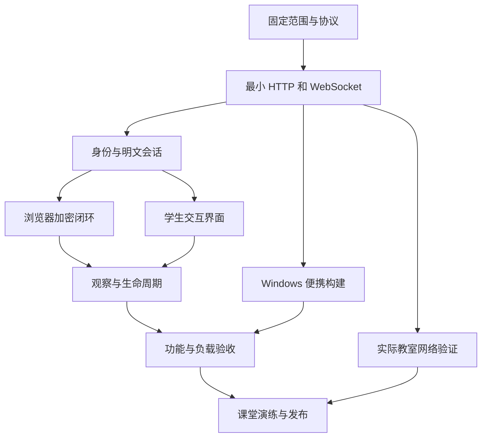

# 局域网加密流量课堂工具原子化实施计划

## 实施目标和使用方法

本计划用于开发一套从 U 盘启动的局域网教学工具：教室电脑提供网页与消息转发服务，学生用手机浏览器输入临时昵称加入，通过圆点与连线建立明文或加密聊天；教师点击会话边查看转发点实际收到的内容和通信特征。全班拓扑共享，聊天正文按参与关系分发，教师控制仅在主机本地开放。

本计划版本为 1.0，日期为 2026 年 10 月 23 日。以下容量、时限和性能数字均为拟采用的配置与验收目标，不是已完成的实测结果。任务初始状态统一为“待执行”。教室系统、网络策略及手机兼容性须按计划现场确认。

执行顺序为：先验证实际 LAN 上的 HTTP 和 WebSocket，再跑通两端真实加密，然后完成拓扑、观察界面、生命周期和便携交付。单个任务通常对应一个可以独立审查的行为或一份必要契约，建议控制在半天以内；某项超过半天时按已有验收结果拆分，不按“创建一个文件”机械拆分。

每个任务都包含编号、前置依赖、执行动作、交付物和完成条件。前置任务完成后才开始依赖实现；使用已冻结协议的前端模拟数据可以并行开发，但不能把模拟结果算成端到端验收通过。

需求对应关系：

| 需求编号 | 用户需求 | 验收结果 |
| --- | --- | --- |
| R01 | U 盘启动、服务端免安装 | 目标 Windows 上双击 EXE，无需 Go、Node.js、Python、抓包驱动或外网 |
| R02 | 手机浏览器访问 A | 实际手机打开显示的 LAN 地址并完成 WebSocket 往返 |
| R03 | 临时昵称和不同圆点 | 唯一临时 ID、昵称和颜色同步到全班拓扑，允许重名并用短编号区分 |
| R04 | 学生选择对象与加密模式 | 邀请方选择明文或加密，对方看到模式并接受 |
| R05 | 建立会话后出现无向边 | 会话状态与边一致，消息活动可显示方向 |
| R06 | 教师点击边查看通信 | 明文会话显示真实正文，加密会话显示真实密文及可见元数据 |
| R07 | 仅简单缓存，关闭清空 | 服务端无聊天持久化；本轮结束清理客户端状态；进程重启无旧数据 |
| R08 | 面向被动观察的课堂演示 | 明确应用层观察口径，加解密在端点完成，A 不接收加密会话明文或私钥 |
| R09 | 与加密流量分析结合 | 展示消息字节数、方向、时间间隔、次数和方向切换 |
| R10 | 可在课堂连续操作 | 断线、刷新、拒绝邀请、超时、清空、满员均有明确反馈 |

## 第一版范围和固定技术方案

第一版支持文本、一对一逻辑会话、多人同时在线、同一参与者最多 3 个待建立或正在通信的会话、教师观察和本轮清空。保留全部用户提出的核心交互。

文件传输、音视频、群聊、WebRTC 直连、真实网卡抓包、TLS 复现、账号密码、数据库、业务分类模型、历史导出和公网部署留到后续单独立项。固定长度填充作为 V1.1 可选项，不阻塞 V1 交付。

| 层次 | 冻结方案 | 理由与边界 |
| --- | --- | --- |
| 服务端 | Go 标准 HTTP 服务，coder/websocket 处理 WebSocket | 小型本地转发服务；依赖版本在 B01 锁定 |
| 前端 | 原生 TypeScript，Vite 构建，学生页和教师页两个入口 | Node.js 只在开发构建机使用，运行时提供编译后的静态文件 |
| 拓扑 | 原生 SVG，固定且稳定的布局，支持选中和局部突出 | 首版避免自动力导向布局持续抖动；节点带昵称和短编号 |
| 加密 | 本地打包的 TweetNaCl.js，使用 nacl.box | 浏览器内生成临时密钥并加解密，不依赖 LAN HTTP 下不可用的 crypto.subtle |
| 随机数 | Go crypto/rand；浏览器 crypto.getRandomValues | 浏览器没有安全随机数时明确报错并禁用加密能力 |
| 二维码 | 本地打包的 qrcode 库 | 编码所选 LAN 地址，运行时无在线二维码服务 |
| 静态资源 | go:embed 内嵌构建产物 | EXE 不依赖旁边的 dist 目录或当前工作目录 |
| 共享状态 | 单个 Hub 事件循环串行修改状态 | 邀请竞争、断线、轮次重置按明确顺序处理 |
| 网络发送 | 每连接一个有界发送队列和独立写入循环 | 一个慢客户端不能阻塞整个 Hub |
| 传输格式 | JSON WebSocket 文本消息，二进制字段用 Base64；关闭 WebSocket 压缩 | 保持协议易检查，并固定观察长度口径 |
| 数据保存 | 有上限的内存缓存 | 默认无数据库、聊天文件、遥测或运行期外部依赖 |

Go 的可执行文件与资源内嵌、Vite 的生产静态构建、所选 WebSocket 与密码库能力，见文末官方来源 [S01]—[S06]。此处指定架构与接口，具体依赖版本由实施时的锁文件确定，不用“latest”作为可复现版本标识。

默认配置：

| 参数 | 默认值 | 说明 |
| --- | --- | --- |
| 首发系统 | Windows 10/11 x64 | 只对实际验证过的系统与版本声明兼容 |
| 学生入口 | 0.0.0.0:8080 | 二维码使用选定的真实 LAN IPv4，不能使用 0.0.0.0 或 localhost |
| 教师入口 | 127.0.0.1:8081 | 独立监听器；不允许配置成对 LAN 开放 |
| 班级规划 | 50 名学生 | 容量验收目标为 100 条学生连接，教师连接另计 |
| 在线参与者上限 | 100 | 满员拒绝并提示，不静默挤掉已在线用户 |
| 公共原始连接上限 | 120 | 包括未加入连接；未加入或恢复认证应在 10 秒内完成 |
| 在线与离线身份总上限 | 200 | 离线身份最多保留 60 秒，避免持续刷新累积 |
| 教师连接上限 | 4 | 与学生连接配额分开 |
| 昵称长度 | 去除首尾空白后 1—16 个 Unicode 码点 | 禁止控制字符；显示时使用纯文本 |
| 每人会话额度 | 3 | INVITED、NEGOTIATING、ACTIVE 合并计数 |
| 邀请超时 | 30 秒 | 邀请到期关闭并释放额度 |
| 加密协商超时 | 15 秒 | 超时关闭，双方显示失败原因 |
| 心跳间隔和失联判定 | 15 秒和 45 秒 | 应用心跳；实际关闭事件可更早触发断线处理 |
| 身份恢复窗口 | 60 秒 | 只恢复同页内存中的身份，不恢复旧会话 |
| 用户正文上限 | UTF-8 4096 字节 | 前端发送前检查；服务端检查明文正文，接收端解密后检查加密正文 |
| 密文上限 | 32 KiB | Base64 解码后的密文本体；覆盖正文 JSON 转义、内部信封和认证开销 |
| 完整 WebSocket 应用消息上限 | 64 KiB | 读取层限制；覆盖 Base64 膨胀和有界外层信封；超限明确拒绝或关闭 |
| 单会话观察历史 | 最近 200 条，正文和密文累计最多 1 MiB | 条数或字节任一达到即淘汰最旧记录 |
| 全局观察历史 | 原始正文和密文累计最多 32 MiB | 淘汰后保留准确累计统计并显示记录截断状态 |
| 已关闭会话元数据 | 最多 200 个或 10 分钟 | 先满足的淘汰；活跃会话另受参与者额度限制 |
| 单连接待写队列 | 最多 64 条或 256 KiB | 任一超限关闭该慢连接并通知相关会话 |
| 聊天发送速率 | 每人每秒 2 条，短时突发 5 条 | 作为课堂默认值；控制消息单独限制 |
| 正常网络回执超时 | 5 秒 | 标为未确认，不自动重发 |
| 客户端聊天缓存 | 每会话 200 条，每页面总量最多 3 MiB | 私钥和消息均不主动持久化 |
| 页面渲染节奏 | 最多每 100 毫秒合并一次活动更新 | 只影响绘制，不改变事件原始时间或精确统计 |

这些上限集中定义，前端从只读配置获取适用值，避免多处散落常量。端口占用时显示原因和显式改端口方式，不静默切换，以免偏离预先放行的防火墙端口。

## 必须保持一致的架构语义

### 观察位置和实际连接

界面 B—C 表示逻辑聊天会话。真实传输连接为 B 到 A、C 到 A，每位学生只有一条到 A 的 WebSocket。教师页从 A 订阅观察记录，不启动网卡抓包。观察动画表示“服务端接受了一条业务消息”，不是网络包、链路路径或实测传播速度。

学生收到全班公开拓扑以及必要活动摘要；只有聊天双方收到该会话正文或密文。教师经本机受保护通道收到观察记录。不得把全部明文聊天广播给全班后再由前端隐藏。

### 教师入口和权限

教师服务单独绑定 127.0.0.1。程序启动生成随机管理 token，自动打开的本机教师 URL 用 fragment 交给页面；页面读入内存后移除地址栏 fragment。token 不出现在学生二维码、公共配置和默认日志中。

教师 WebSocket 首条认证消息验证 token，同时验证 Origin 与实际请求 Host 符合本机入口。管理身份由监听器和鉴权决定，不接受学生上报 role=admin。公共监听器不注册管理操作和观察正文接口；管理 HTTP 操作如存在，必须使用带认证的非 GET 请求。默认不启用跨域访问。

本地入口和 token 属于应用权限隔离，课堂加密模型仍限定为“客户端程序可信，网络观察者不主动篡改网页或公钥”。它不构成对恶意主机、恶意网页分发者或任意主动中间人的安全承诺。[S04][S08]

### 断线和恢复

1. 页面检测到 WebSocket 关闭即禁发，清除本页相关会话密钥与旧聊天状态。
2. Hub 关闭该身份的全部邀请和会话，并通知对端；服务端尚未检测到的失联最迟按心跳判定。
3. 同一页面可在 60 秒内，使用仅存于内存的 resume_token 恢复 participant_id、昵称、短编号和颜色。
4. 恢复成功生成新的 connection_epoch 并轮换 resume_token；旧连接回调不能影响新连接。
5. 恢复身份后重新获取拓扑，旧会话、旧密文和未确认消息不恢复、不自动重发。
6. 页面刷新、恢复窗口超时或轮次改变时创建新身份，重新输入昵称。
7. 合法恢复请求即使先于旧连接的心跳超时到达，也先关闭旧会话与旧连接，再绑定新连接；任意时刻仅一条连接控制该身份。

教师刷新页面不结束课堂；若内存管理 token 丢失，提示在程序控制台使用“重新打开教师页”动作重新进入。关闭教师浏览器页面或标签页不会停止服务端。关闭承载 EXE 的 Windows 控制台窗口可能终止程序；正常退出使用教师页的“退出程序”按钮或程序控制台中的明确退出命令。重新打开教师页使用现有服务进程和当前轮次，不启动第二个服务进程。

### 轮次和结束

课堂状态为 RUNNING 或 ENDED。“新一轮”原子地生成新 round_id、清空用户与会话、失效恢复 token、清空观察记录，并使学生回到加入页。“结束课堂”完成同样清理后进入 ENDED，暂停新加入，直到教师开始下一轮。

重置请求携带 request_id 与 expected_round_id。管理操作的幂等结果保存在进程级有界缓存中，不随本轮清空；同一认证教师、相同 request_id 和载荷的重试先命中原结果，不得再次重置。相同 request_id 改载荷报错；缓存淘汰后的重试再受 expected_round_id 校验约束。已清空的旧轮次消息、旧定时器、旧发送队列项和迟到回执不能创建新状态。

正常退出先发结束通知、有限等待再关闭连接与监听器。异常退出由客户端在发现断连后执行清理；没有执行中的页面、系统级痕迹和用户截图不属于本工具的清理承诺。

### 密钥与 nonce

每个加密会话在两端新建临时密钥对。A 只转交公钥，私钥及预计算共享秘密只在浏览器内存。双方公钥在本会话固定，公钥变化关闭会话，不静默替换。

nonce 固定为 24 字节：1 字节方向标记、15 字节安全随机前缀、8 字节大端单调计数。邀请方方向为 0，接受方为 1；各发送方创建会话时生成自己的前缀。计数从 0 开始，加密确认与聊天共用本方向计数；每次加密先分配再递增，失败也不回退，计数耗尽关闭会话。浏览器用 BigInt，协议中的 seq 用十进制字符串，避免 JavaScript Number 精度问题。

对于加密 key.confirm 和 chat.send，外层 seq 必须等于 nonce 最后 8 字节计数的规范十进制字符串：除 0 本身外无前导零，范围为 0 至 2^64−1。内部加密信封的 seq 与外层相同。接收者在成功认证并校验 key-confirm 后固定对端随机前缀；方向必须符合对端邀请方或接受方身份。后续消息须保持方向与前缀一致、计数严格增加；只有认证、解密、上下文和正文长度检查全部通过后，才推进接收水位。

上述规则用于保证同一会话密钥下的 nonce 管理，不自行实现密码算法。公钥 32 字节、nonce 24 字节、认证开销等原语要求遵守库说明。[S04]

### 加密就绪和错误处理

对方接受后，加密会话进入 NEGOTIATING。两端交换公钥，并发送经过 nacl.box 保护、绑定 round_id、session_id 和双方身份的 key-confirm 控制消息；成功解密并验证对端确认后上报 ready。Hub 收齐两端 ready 才转为 ACTIVE。

Hub 依据客户端的 ready 报告推进状态，不声称自己验证了秘密。确认消息不计入聊天条数或消息动画。密文认证失败、上下文不匹配、nonce/序号不合规则提示失败并关闭相关会话；不回退到明文。

### 消息和统计

A 依据真实连接确定 sender_id，验证会话成员、round_id、connection_epoch、模式和长度。每条被接受的业务消息仅生成一次观察事件；A 到接收方的转发、回执、心跳和密钥确认均不重复计数。

记录字段至少区分 payload_bytes 与 ws_message_bytes。明文前者为正文 UTF-8 字节数，加密前者为 Base64 解码后的密文本体字节数；后者为 A 实际收到的完整 WebSocket 应用消息 UTF-8 字节数。两者都不是 IP/TCP 包长，不包含底层链路的完整开销。[S07]

服务端同时记录显示用的 UTC 时间和本进程单调时间。消息间隔按同一会话、按 Hub 接受顺序的相邻业务事件计算；不用不同手机的时钟差计算网络时延。

会话累计消息数、累计字节数、最后方向和累计方向切换独立保存，不因历史淘汰而减少。时间轴只显示当前保留窗口，并明确有无被淘汰的记录。方向由固定双方定义，不随当前选中者改变。

接收端 ACK 的含义是“接收端程序报告已成功处理”。明文在解析和加入本地消息后确认，加密在认证、解密、上下文校验和加入本地消息后确认。界面写“接收端已确认”，不能写“本人已读”，服务器也不能据此宣称独立验证了解密。

### 不持久化

业务数据只存内存，不写 localStorage、sessionStorage、IndexedDB、数据库或默认文件日志。不使用 Service Worker 缓存课堂状态。错误记录只保留代码、计数、版本等必要信息，不带私钥、恢复 token、管理 token 或加密会话正文。页面中的昵称和所有正文均用纯文本渲染。

## 协议和模块契约

### 服务入口

| 入口 | 监听器 | 作用 |
| --- | --- | --- |
| GET / | 学生端口 | 学生页面 |
| GET /assets/... | 两个监听器各自提供所需资源 | 本地静态文件，不从远程加载 |
| GET /api/config | 学生端口 | 协议版本、当前轮次状态、公开限额和能力 |
| GET /healthz | 学生端口 | 程序是否运行；不泄露身份或消息 |
| /ws | 学生端口 | 加入、恢复、邀请、协商、聊天、回执和退出 |
| GET / | 教师端口 | 教师页面 |
| /ws/admin | 教师端口 | 管理认证、观察订阅、轮次控制 |

教师页面与学生页面可以复用组件，但监听器、身份校验和消息可见性必须在服务端分开。

### 公共信封

所有消息带 v 和 type。已加入的客户端命令还带 request_id、round_id、connection_epoch；会话命令带 session_id。消息发送带 message_id、seq，seq 使用十进制字符串。sender_id 由 A 填写，客户端不得通过外层字段冒充他人。

round_id、participant_id、session_id、message_id、request_id 和 connection_epoch 统一使用 16 个安全随机字节编码为 32 位小写十六进制字符串。管理 token 与恢复 token 使用 32 个安全随机字节的无填充 Base64url 编码；seq 最多 20 位且必须通过 uint64 范围检查。协议解析限制字段长度、拒绝不允许的额外字段，防止信封元数据绕过消息预算。

join 与 resume 在获得本次 connection_epoch 之前使用其专用结构。服务端推送依接收连接附带当前连接代次；不能把某个发送者的 connection_epoch 当作所有接收者的代次广播。

正常聊天序号单调递增，允许因本地失败产生间隔，不允许倒退或重复处理。同一 session_id、sender_id、message_id 的相同重试返回已知处理结果；相同 ID 携带不同载荷返回 ID_CONFLICT。消息去重记录有界；已超出窗口的旧序号不能作为新消息重新接受。首版客户端不自动重发聊天。

### 消息族

| 方向 | 消息类型 | 主要含义 |
| --- | --- | --- |
| 学生到 A | join / resume | 创建或恢复临时身份 |
| A 到学生 | welcome / snapshot | 返回身份、恢复 token、代次、轮次和公开拓扑 |
| 学生到 A | invite.create / invite.respond / invite.cancel | 发出、接受、拒绝和取消邀请 |
| A 到学生 | session.changed | 会话状态和固定模式变化 |
| 学生与 A | key.publish / key.confirm / key.ready | 转交公钥、加密确认、上报准备完成 |
| 学生到 A | chat.send | 发送明文或 nonce 加密文 |
| A 到收件人 | chat.deliver | 转发已验证归属的消息 |
| A 到发件人 | chat.accepted | A 已接受该消息，不等于收件人已确认 |
| 收件人到 A | chat.receipt | 成功处理或解密失败的结果，只带关联 ID 和状态 |
| A 到相关端 | chat.status | 确认、未确认或发送失败 |
| 学生到 A | session.close / leave | 关闭会话或离开 |
| 双向 | ping / pong | 连通性维护，不计聊天统计 |
| A 到学生 | topology.changed / activity.batch | 公开状态变化和业务活动摘要 |
| 教师与 A | admin.auth / observer.subscribe / observer.snapshot / observer.event | 鉴权及选定会话的观察记录 |
| 教师到 A | round.reset / class.end / class.start / server.shutdown | 本机课堂控制 |
| A 到客户端 | round.ended / error | 本轮结束或结构化错误 |

采用可序列化的结构化错误：code、request_id、可选 session_id、简短用户提示。至少覆盖 INVALID_MESSAGE、VERSION_MISMATCH、STALE_ROUND、STALE_CONNECTION、NOT_MEMBER、NOT_ACTIVE、MODE_MISMATCH、CAPACITY_REACHED、INVITE_EXPIRED、KEY_TIMEOUT、MESSAGE_TOO_LARGE、RATE_LIMITED、ID_CONFLICT、CRYPTO_FAILED、RESUME_EXPIRED、CLASS_ENDED、SLOW_CLIENT。

### 加密业务载荷示例

下列是构造规范示意，字段中的字符串为占位符，不是可以直接发送的测试值。

```json
{
  "v": 1,
  "kind": "chat",
  "round_id": "<current-round>",
  "session_id": "<current-session>",
  "message_id": "<random-message-id>",
  "sender_id": "<sender>",
  "recipient_id": "<recipient>",
  "seq": "1",
  "text": "<student-input>"
}
```

先把以上内部信封编码成 UTF-8，再用 nacl.box 加密。外层 chat.send 只包含路由与版本字段、message_id、seq、nonce_b64 和 ciphertext_b64，不包含 text、plaintext、私钥、明文 hash 或明文备份。接收者解密后逐项校验内外上下文，并强制检查正文 UTF-8 字节数不超过 4096。服务端不能检查加密正文长度，只检查密文、外层字段和完整应用消息的预算。

由于加密输入包含内部信封，密文长度对应“整个内部信封的字节数加认证开销”，不能把用户文字字节数加 16 当作这里的完整密文长度。观察面板使用 A 实际收到的长度。消息 ID 用安全随机字节编码，不依赖 LAN HTTP 下同样可能受安全上下文限制的 crypto.randomUUID。

### 状态模型

| 对象 | 主要状态 | 关键转换 |
| --- | --- | --- |
| 参与者 | ONLINE、OFFLINE、REMOVED | 加入或恢复到 ONLINE；连接关闭到 OFFLINE；60 秒后 REMOVED |
| 会话 | INVITED、NEGOTIATING、ACTIVE、CLOSED | 明文接受后 ACTIVE；加密接受后 NEGOTIATING，双方 ready 后 ACTIVE |
| 课堂 | RUNNING、ENDED | 结束清理后 ENDED；开始或重置生成新 round_id |
| 消息显示 | SENDING、ACCEPTED、CONFIRMED、UNCONFIRMED、FAILED | 只由相应事件推进；5 秒无确认标 UNCONFIRMED，迟到确认可更新 |

每对参与者在同一轮次只允许一个未关闭会话，明文和加密模式都计入这一限制。双向同时邀请由 Hub 顺序处理，后到者收到当前会话状态而不是生成第二条边。关闭后可以重新邀请并选择另一模式。

### 目录职责

| 路径 | 责任 |
| --- | --- |
| cmd/traffic-classroom/ | 程序入口、参数、启动和退出 |
| internal/config/ | 配置与限额 |
| internal/protocol/ | Go 消息结构、解析和错误码 |
| internal/hub/ | 参与者、会话、轮次、幂等与状态转换 |
| internal/transport/ | HTTP 和 WebSocket、监听器、读写队列、来源校验 |
| internal/observe/ | 观察事件、统计和有界历史 |
| internal/platform/ | 网卡候选、默认浏览器打开、Windows 交互 |
| internal/web/ | go:embed 与构建产物提供 |
| web/src/shared/ | 协议、状态、连接和纯文本组件 |
| web/src/crypto/ | 密码适配、密钥注册表、nonce、载荷校验 |
| web/src/student/ | 学生加入、邀请和聊天 |
| web/src/teacher/ | 教师拓扑、观察和课堂控制 |
| web/src/graph/ | SVG 节点、边、选中和方向动画 |
| docs/ | 需求、协议、环境、验收、操作说明和进度 |
| scripts/ | 构建、有限并发测试和发布打包 |

以上是计划中的项目相对路径，不表示当前已经创建或实现了这些模块。

## 原子任务清单

共 96 项 V1 核心任务，按 11 个阶段组织；每项初始状态均为待执行。每个任务行可作为一个开发工单，具体前置依赖以编号为准。

### 阶段 A 范围和契约

用明确契约消除开发中的分歧，所有后续模块引用同一份协议。

| 编号 | 前置依赖 | 原子任务 | 交付物 | 完成条件 |
| --- | --- | --- | --- | --- |
| A01 | 无 | 把 R01—R10 转为可追踪需求 | docs/requirements.md | 每项用户需求对应界面行为、数据边界和验收编号；V1 与可选扩展分开。 |
| A02 | A01 | 固定环境和集中配置表 | docs/environment.md 与配置结构 | 记录真实已知环境；未知项标待确认；端口、人数、限额和超时与本计划一致。 |
| A03 | A01、A02 | 固定状态机及重连语义 | docs/state-machine.md | 邀请、协商、关闭、恢复身份和重置均有合法转换；CLOSED 不可复活。 |
| A04 | A03 | 固定消息协议和权限可见性 | docs/protocol.md 与正常/异常 JSON 样例 | 每种消息都有发送角色、字段、验证规则、响应和错误码；公共事件不含私密字段。 |
| A05 | A04 | 固定密码载荷和观察指标口径 | docs/crypto-and-observation.md | nonce、加密内部信封、双端 ready、两种长度和单调时间定义无歧义。 |
| A06 | A01、A04、A05 | 建立验收案例和证据表 | docs/acceptance.md | 每项 R 需求至少映射一项验收；区分开发机结果、真机结果和现场结果。 |

### 阶段 B 最小服务和真实局域网验证

尽早证明目标环境能打开页面并交换消息，避免界面完成后才发现网络不可达。

| 编号 | 前置依赖 | 原子任务 | 交付物 | 完成条件 |
| --- | --- | --- | --- | --- |
| B01 | A02 | 建立 Go 工程并锁定服务端依赖 | go.mod、go.sum 与入口骨架 | 开发机可以构建空服务；记录 Go 和 WebSocket 库版本，不运行时下载依赖。 |
| B02 | A02 | 建立双入口 TypeScript 构建工程 | web 工程、锁文件和生产构建脚本 | 学生与教师页面生成静态产物；密码库、二维码库均从锁文件安装并打包。 |
| B03 | B01、B02 | 将前端产物嵌入程序并提供静态访问 | internal/web 资源模块 | 删除外部 dist 后已构建程序仍能提供页面；静态路径不能访问嵌入范围外的文件。 |
| B04 | B03 | 启动公共和本机两套 HTTP 监听器 | 监听器与端口错误处理 | 公共入口可绑定 LAN；管理入口固定 loopback；任一启动失败都不显示完整启动成功。 |
| B05 | B04、A04 | 建立最小 WebSocket 往返入口 | 开发期 echo 和来源校验 | 网页实际发送并收到往返消息；不支持的 Origin、过大消息明确拒绝；压缩关闭。 |
| B06 | B02、B04 | 枚举候选网卡并生成所选地址二维码 | 地址选择与本地二维码组件 | 二维码和可复制地址一致；自动排除 loopback，虚拟网卡可识别并手动更换。 |
| B07 | B03、B04 | 制作最早可运行的 Windows 开发包 | 开发版 EXE 与启动提示 | 目标 Windows 双击后打开本机页面；不需要开发运行时；端口冲突提示可读。 |
| B08 | B05、B06、B07 | 用实际教室网络验证 HTTP 和 WebSocket | 真实手机访问记录 | 两部手机经实际课堂网络完成页面加载和往返；记录访问路径与结果，不能用电脑自测替代。 |

### 阶段 C 状态中心和参与者接入

建立可靠的连接、身份和公开拓扑基础。

| 编号 | 前置依赖 | 原子任务 | 交付物 | 完成条件 |
| --- | --- | --- | --- | --- |
| C01 | A04、B05 | 实现协议解析和结构化错误 | internal/protocol 模块 | 未知版本、类型、缺失字段、非法 Base64 和字段越界进入确定错误分支。 |
| C02 | A03、B01 | 建立内存模型和随机标识生成 | 参与者、会话、连接、轮次模型 | 身份、轮次、连接代次各司其职；ID 和 token 用安全随机数生成。 |
| C03 | C01、C02 | 实现 Hub 串行状态循环 | internal/hub 核心 | 连接与定时器只提交命令；共享状态只有 Hub 修改，快照与状态转换按同一顺序生成。 |
| C04 | B05、C01、C03 | 封装正式连接读写与有界队列 | internal/transport 连接对象 | 只有一个写出口；Hub 不等待网络写入；读大小、写超时和队列字节数均受控。 |
| C05 | B04、C01、C04 | 实现本机教师鉴权 | 管理 token 和 Origin 校验 | 公共入口不能获得管理角色；错误 token 或错误来源不能订阅观察或控制课堂。 |
| C06 | C02、C03、C04 | 实现临时昵称加入 | join 与 welcome 处理器 | 中文昵称可加入；重名显示短编号；回复包含本人的身份与恢复 token，不泄露给别人。 |
| C07 | C05、C06 | 实现公开快照和拓扑版本 | snapshot 与 topology.changed | 在线名单一致；快照能重新建立当前画面；公开投影无正文、密文、token 或密钥。 |
| C08 | C03、C04、C06 | 实现心跳和连接代次校验 | 活性检查与旧连接事件过滤 | 失联按规则检测；旧 epoch 的消息和关闭回调不能改变当前连接状态。 |
| C09 | A02、C01、C06 | 实现接入和操作限额 | 集中限额与令牌桶 | 满员、过大消息、发送过快均有明确结果；未加入连接在超时后释放。 |

### 阶段 D 会话和明文消息闭环

先把邀请、转发、确认和关闭做成完整业务链路。

| 编号 | 前置依赖 | 原子任务 | 交付物 | 完成条件 |
| --- | --- | --- | --- | --- |
| D01 | C03、C06、C09 | 实现邀请创建和参与者配对唯一性 | invite.create 处理器 | 不能邀请自己或离线者；双向同时邀请只存在一个未关闭会话；额度正确扣减。 |
| D02 | D01、A03 | 实现接受拒绝与撤销 | invite.respond 和 invite.cancel | 只有被邀请人能接受；明文接受进入 ACTIVE，加密接受进入 NEGOTIATING。 |
| D03 | D02 | 实现会话关闭及额度释放 | session.close 与关闭原因 | 任一方关闭后双方获知；重复关闭无副作用；旧 session_id 不能再接受聊天。 |
| D04 | C01、C08、D02 | 实现业务命令归属检查 | 轮次、代次、成员和模式守卫 | 外部 sender_id 无法冒充；非成员、旧轮次、未 ACTIVE 或模式不符的消息被拒绝。 |
| D05 | C04、C09、D04 | 实现明文消息定向转发 | 明文 chat.send 路径 | A 按 UTF-8 检查长度；只向对端转发正文；没有第三位学生收到该正文。 |
| D06 | D05 | 实现消息 ID 去重和发送序号水位 | 有界去重缓存 | 重复消息返回原结果但不重复转发；相同 ID 不同载荷报错；过旧序号不能重新接受。 |
| D07 | D06 | 实现接收端确认的状态更新 | chat.receipt 与 chat.status | 仅预期收件人可确认；重复确认无副作用；界面状态来源可追溯到确认事件。 |
| D08 | C07、D06 | 生成公共消息活动摘要 | activity.batch 事件 | 公开内容只含会话、方向、消息 ID 等必要摘要；一条逻辑消息只触发一次活动。 |
| D09 | C03、D02、D03 | 实现邀请与协商到期处理 | 超时命令和关闭状态 | 到期接受无效；超时释放会话额度；旧定时器不会关闭后续新会话。 |
| D10 | D03、D07 | 实现未确认和传递失败反馈 | 5 秒确认超时和关闭反馈 | 没有收件人确认不显示已确认；迟到确认可更新；首版不自动重发聊天。 |

### 阶段 E 浏览器真实加密闭环

让 A 仅处理密文，双端仍能阅读原文，并明确控制密钥生命周期。

| 编号 | 前置依赖 | 原子任务 | 交付物 | 完成条件 |
| --- | --- | --- | --- | --- |
| E01 | A05、B02 | 封装密码库和浏览器能力检查 | web/src/crypto 适配层 | LAN HTTP 下通过安全随机数与编码能力检测；缺失能力明确提示，不使用 Math.random。 |
| E02 | E01 | 实现按会话索引的临时密钥注册表 | 内存 key vault | 每个新会话生成新密钥对；私钥不进入可序列化公开状态或任何上传路径。 |
| E03 | E02、A05 | 实现唯一 nonce 分配器 | 方向、随机前缀和 BigInt 计数模块 | 同一方向不重复，两方向空间分离；seq 等于 nonce 计数；失败不回退，计数耗尽关闭会话。 |
| E04 | D02、D04、E02 | 实现固定公钥提交和定向交付 | key.publish 双端与服务端路径 | 只接受协商中成员的 32 字节公钥；已固定的公钥不得静默替换。 |
| E05 | E03、E04 | 实现加密 key-confirm 的生成和验证 | 加密确认控制消息 | 确认绑定轮次、会话、双方身份和 seq；验证成功才固定对端 nonce 前缀及接收水位；不显示成聊天消息。 |
| E06 | E05、D09 | 实现双方 ready 后的激活门槛 | key.ready 与 ACTIVE 推送 | 只收到一方 ready 时不能聊天；双方确认且未超时才激活；失败关闭并说明原因。 |
| E07 | E03、E06、A05 | 实现聊天的内部信封与加密出口 | 加密 chat.send 构造器 | 发出的业务消息只有 nonce、真实密文和允许的外层字段，不含正文或明文派生摘要。 |
| E08 | E04、E06、D07 | 实现解密上下文校验与确认 | 接收端解密管线 | 认证、内外上下文、nonce/seq、重放和解密正文长度检查通过后才显示、推进水位和确认；失败关闭会话。 |
| E09 | E06、E07、D06、D07 | 实现只接受密文字段的服务端路径 | 加密消息中继 | 验证 nonce 方向与 seq、密文上限和状态；拒绝加密消息中的 text/privateKey 等额外字段；无服务端解密入口。 |
| E10 | E02、E03、D03 | 实现统一密钥销毁入口 | 按会话和连接清理 API | 关闭后不再取得旧密钥或分配 nonce；清理可重复调用；清零可控字节数组并释放引用。 |

### 阶段 F 学生界面和共享拓扑

让学生独立完成加入、邀请、聊天，并清楚理解当前连接与会话状态。

| 编号 | 前置依赖 | 原子任务 | 交付物 | 完成条件 |
| --- | --- | --- | --- | --- |
| F01 | B02、C01、C07 | 建立前端连接适配器和内存状态仓库 | 共享连接与状态模块 | 所有发送走统一出口；快照可重建状态；旧轮次、旧连接代次和重复事件不污染界面。 |
| F02 | F01、C06、E01 | 实现昵称加入页 | 加入表单与错误状态 | 中文昵称与重复昵称可用；未连接、加入中、满员和加入成功均可区分。 |
| F03 | F02、D02、D09 | 实现选择对象与邀请交互 | 对象列表、模式选择和邀请卡片 | 双方接受前均能看到模式；重复点击不生成多个邀请；拒绝与到期提示明确。 |
| F04 | F02、C07 | 实现稳定布局的在线节点 | SVG 节点与昵称列表 | 节点与服务端名单一致；本人突出；昵称和编号可见；新增节点不使全图持续跳动。 |
| F05 | F04、D03、E06 | 实现会话边和选中行为 | 逻辑边、状态和模式标识 | 等待、协商和 ACTIVE 有对应样式；可通信边带明文或加密文字；学生只能进入自身会话。 |
| F06 | F03、D05、E07 | 实现聊天输入和发送 | 文本输入、字节计数和发送按钮 | 正文上限按 UTF-8；IME 组词回车不误发；只有 ACTIVE 且连接正常时可发送。 |
| F07 | F06、D10、E08 | 实现聊天列表与确认状态 | 纯文本消息和状态组件 | 双方看到正确文字；无确认不显示已确认；HTML 字符仅作文字显示。 |
| F08 | F07、A02 | 实现多会话切换与客户端缓存限额 | 会话标签和内存历史 | 切换不会串会话；记录达到条数或字节上限可控淘汰，并提示当前保留范围。 |
| F09 | F05、D08 | 实现有方向的业务消息动画 | 有界动画队列 | 仅首次接受的聊天触发一次；控制消息不触发；高频时合并显示但不修改统计。 |
| F10 | F02、F05、F07、F09 | 完成手机布局和基本可访问性 | 响应式学生页 | 360 像素宽度可操作；软键盘不遮住关键输入；状态不只靠颜色；减少动画偏好可用。 |

### 阶段 G 教师观察和统计

把转发点得到的真实信息以准确口径展示给全班。

| 编号 | 前置依赖 | 原子任务 | 交付物 | 完成条件 |
| --- | --- | --- | --- | --- |
| G01 | B02、C05 | 实现教师启动认证 | 教师页 token 引导 | token 读入内存后移出地址栏；未认证不能订阅；不把 token 发到学生服务。 |
| G02 | G01、B06、F04、F05 | 组合教师主界面 | 加入二维码、人数、拓扑和侧栏 | 投屏能读出地址和昵称；选择边进入对应观察区；教师不被误计为一个学生。 |
| G03 | A05、D06、E09 | 从接受消息的位置生成观察事件 | 真实字节与时间采集模块 | 每个首次接受的业务消息只生成一次；不用客户端自报长度或时间替代测量。 |
| G04 | G03、A02 | 实现有界观察历史 | 会话与全局历史缓存 | 条数、字节预算都有效；淘汰计数明确；所保留内容为实际明文或密文。 |
| G05 | G03 | 实现会话累计统计 | 双向计数、字节、间隔和方向切换 | 去重消息和控制消息不计入；累计值不随历史淘汰回退；首条间隔为空。 |
| G06 | C05、G04、G05 | 实现教师选择会话的历史与实时订阅 | observer.snapshot 和 observer.event | 切换订阅不串记录；快照和实时边界不重不漏；学生角色无法取得观察正文。 |
| G07 | G06 | 实现观察记录列表 | 明文或密文预览与字段说明 | 密文来自真实载荷；截断只影响显示；两种长度和确认含义明确，敏感文本不执行。 |
| G08 | G05、G07 | 实现方向长度时间轴 | 应用消息时间轴和统计卡片 | 轴标签明确单位与口径；渲染节流不改变原始时序；标明当前窗口及历史淘汰。 |
| G09 | G02、G08 | 实现聚焦筛选和暂停观察显示 | 会话筛选与显示控制 | 暂停只冻结观察显示，聊天继续；恢复时重新同步有限历史，并提示未保留部分。 |
| G10 | G01、H03、H04 | 实现本轮重置结束与程序退出按钮 | 教师课堂控制 | 操作发送 expected_round_id；服务端确认后才改变界面；重复点击不重复重置。 |

### 阶段 H 断线恢复和课堂生命周期

处理手机后台、旧连接回调和课堂重置，保证缓存与密钥不会跨轮次混用。

| 编号 | 前置依赖 | 原子任务 | 交付物 | 完成条件 |
| --- | --- | --- | --- | --- |
| H01 | C08、D03、D09 | 实现参与者离线时的会话级联关闭 | 断线清理处理器 | 其邀请和会话全部关闭并释放额度；对端收到原因；旧 epoch 回调不影响新连接。 |
| H02 | H01、C06、E10、F01 | 实现同页身份恢复 | resume 与恢复提示 | 60 秒内可沿用 ID 和昵称但换代次、换 token；先关闭旧连接与会话；旧聊天不恢复。 |
| H03 | C03、D03、G04、G05、G06、H02 | 实现幂等且原子的本轮重置 | round.reset 与进程级操作缓存 | 一次请求只生成一轮；旧身份、token、会话、历史、统计、订阅、快照游标与排队项同时失效；在途旧消息不进入新轮次。 |
| H04 | H03 | 实现结束开始和正常退出 | class.end、class.start、server.shutdown | ENDED 拒绝新加入；开始生成新轮次；正常退出先通知再有限等待关闭，不无限阻塞。 |
| H05 | E10、F08、H03、H04 | 绑定前端统一清理与重新加入 | 会话、连接、轮次清理函数 | 断线、结束、刷新恢复策略一致；旧定时器和异步回调不能重新写回旧聊天或密钥。 |
| H06 | C04、H01 | 实现慢连接溢出和写超时处置 | SLOW_CLIENT 错误与断开路径 | 队列满或写超时只关闭受影响连接；不静默丢聊天；教师慢连接不阻塞学生。 |
| H07 | C09、G04、F08、H02 | 收紧所有运行期状态的保留上限 | 统一内存与过期清理规则 | 离线身份、关闭会话、去重结果、管理员操作结果和活动队列都有有限保留策略。 |
| H08 | C01、C05、E09、F07、G07 | 审核文本渲染与日志字段 | 输入和敏感字段检查记录 | 昵称、聊天和错误不执行 HTML；默认日志及诊断不含正文、密钥和任何 token。 |

### 阶段 I Windows 便携构建和操作说明

把已实现的功能交付为真正可以从 U 盘启动的程序。

| 编号 | 前置依赖 | 原子任务 | 交付物 | 完成条件 |
| --- | --- | --- | --- | --- |
| I01 | B01、B02、B03 | 建立可重复的 Windows 构建流程 | 构建脚本和版本信息 | 先构建静态资源再编译 windows/amd64；使用锁文件；构建产物内含全部资源。 |
| I02 | I01、C05、G01 | 完善双击启动和打开本机教师页 | Windows 启动流程 | 两个监听器就绪后才打开教师页；token 正确传入；控制台提供重新打开动作；失败时给可操作提示。 |
| I03 | I02、B06 | 完善网卡选择和显式端口配置 | 地址设置和启动参数 | 选定地址驱动二维码与复制按钮；不会展示 0.0.0.0；冲突后不静默换端口。 |
| I04 | I03、C08、H08 | 提供最小启动诊断 | 版本、地址、端口和连接状态提示 | 教师能区分程序未运行、地址选错、尚无手机连接；不把本机自检当作远端可达证明。 |
| I05 | I01、E01 | 审核运行期离线资源 | 资源清单和依赖检查结果 | 无远程脚本、字体、二维码 API、运行时安装或外部遥测；所有引用可由本地提供。 |
| I06 | I01、I05 | 整理版本许可证和校验信息 | 版本清单、第三方许可、SHA-256 | 记录实际库版本和可执行文件校验值；许可文本可随包提供或内嵌查看。 |
| I07 | I02、I03 | 消除路径和工作目录依赖 | 路径兼容处理 | 程序从中文、空格路径和不同盘符启动时资源寻址一致；不要求向 U 盘写聊天数据。 |
| I08 | I04、G10、H04 | 编写教师使用说明和备用演示步骤 | README 与课堂操作卡 | 覆盖启动、加入、模式、观察、结束、故障排查和本机双学生演示；明确浏览器标签页、程序窗口和退出操作的区别。 |

### 阶段 J 针对主要风险的验证

用有限但有效的验证证明功能与边界，避免把页面看起来正常当作完成。

| 编号 | 前置依赖 | 原子任务 | 交付物 | 完成条件 |
| --- | --- | --- | --- | --- |
| J01 | D09、E06、H02、H03 | 验证状态竞争和轮次幂等 | Hub 场景测试与 race 结果 | 互邀、重复接受、超时、旧连接回调、重置重试结果确定；没有共享状态数据竞争。 |
| J02 | E08、E09、F02、F03、F06、F07 | 验证 LAN HTTP 下完整加密闭环 | 双端加密功能记录 | 以非 localhost HTTP 来源加入、接受并互发中文与长短文本；协商完成前不能发送。 |
| J03 | J02、G03、H08 | 核验加密路径不向 A 传出秘密 | 已知正文标记与字段路径检查 | 接收端解密正确；A 的业务输入、教师接口、公共广播和默认日志无测试明文或私钥；明文模式作正对照。 |
| J04 | C05、D04、G06、H03 | 验证角色和会话权限 | 权限测试记录 | 手机不能使用管理接口；第三位学生不能订阅正文、发送到别人会话或伪造确认。 |
| J05 | D06、E08、H08 | 验证异常消息与密文失败 | 协议负例记录 | 覆盖正文 4096 UTF-8 字节及多 1 字节、需大量 JSON 转义文本的两种模式、非法字段、重复 ID 改内容、nonce/seq 错误、篡改密文与上下文不符；不崩溃、不降级。 |
| J06 | G10、H03、H04、H05 | 验证重置结束与在途消息 | 生命周期集成记录 | 发送中重置、重复重置、结束后再加入、正常退出和重启均符合契约，旧数据不能回流。 |
| J07 | I05、F07、G08 | 用无外网的新页面验证离线运行 | 离线功能记录 | 保留 LAN、阻断 WAN 后重新打开页面；二维码、明文、加密和拓扑均可用，不借旧缓存过关。 |
| J08 | J02、F10、G08 | 执行 Android 与 iPhone 双向验收 | 真机兼容矩阵 | 记录具体系统与浏览器版本；两者分别作为发送者和接收者完成邀请与明文/加密会话。 |
| J09 | J08、H02、H05 | 验证手机后台刷新和恢复 | 真机生命周期记录 | 锁屏、切后台、Wi-Fi 暂断、同页恢复与刷新无幽灵会话、自动重发或错误密钥沿用。 |
| J10 | E09、G08、H06 | 执行目标规模的代表性负载 | 100 学生连接负载报告 | 持续 5 分钟，成对会话、明文加密混合，每端约 5 秒一条；记录确认时延、失败、队列和内存。 |
| J11 | I06、I07、G10 | 在 Windows 和实际 U 盘路径验收 | 便携运行记录 | 无开发运行时可从 U 盘启动；覆盖中文/空格路径、端口冲突、防火墙和双监听器；教师刷新后能从程序控制台重开并恢复观察，不重置课堂、不另启进程。 |
| J12 | J10、H06、H07 | 验证缓存上限和慢接收端隔离 | 边界负载结果 | 超过历史与队列阈值时按规则淘汰或断开；其他会话继续；淘汰后累计统计正确。 |

### 阶段 K 课堂演练和交付

把软件测试结果落实到最终教室版本与实际操作流程。

| 编号 | 前置依赖 | 原子任务 | 交付物 | 完成条件 |
| --- | --- | --- | --- | --- |
| K01 | B08、J08、J11 | 用最终候选版重新验证课堂网络 | 现场记录 | 使用准备上课的 EXE、盘符、电脑接入和学生 Wi-Fi 完成真实收发，不能仅复用开发版结果。 |
| K02 | I08、G10、G09、J09 | 演练教学流程和保底流程 | 课堂演练记录 | 完成明文、加密、长度/节奏观察和新一轮；本机两名学生的备用演示也实际运行。 |
| K03 | J01、J03、J04、J05、J06、J07、J12、K01、K02 | 修复阻塞问题并做相关回归 | 关闭后的阻塞清单 | 只针对已发现问题补验证；网络、真实加密、权限、清理或主要交互仍失败时不能标可上课。 |
| K04 | K03、I06、I08 | 生成正式发布目录 | EXE、使用说明、许可和校验值 | 发布文件与测试版本一致；临时调试入口关闭；开发依赖和聊天测试数据不混入发布包。 |
| K05 | K04、A06 | 填写最终验收和交接记录 | 签收式发布检查表 | 96 项核心任务有状态与证据；未实测环境不声称支持；确认课堂主流程和备用流程都可执行。 |

### 可选扩展

以下 4 项在 K05 完成后再实施，不纳入 V1 的课堂放行条件。

| 编号 | 前置依赖 | 原子任务 | 交付物 | 完成条件 |
| --- | --- | --- | --- | --- |
| X01 | K05 | 实现加密前固定长度填充 | 可选填充模式 | 对限定大小的内部信封填充后加密；原始长度放在加密内容内，不明文上传。 |
| X02 | X01 | 实现填充前后观察对照 | 对照视图和额外字节统计 | 相同填充档内的长度线索减弱；统计仍基于实际收到字节，不推断原始正文长度。 |
| X03 | K05 | 加入可控的教学消息节奏 | 端点生成的演示消息 | 清楚标为演示参与者；真实走现有协议与加密路径；观察页不读取预设标签作推断。 |
| X04 | K05 | 增加逻辑会话与实际中继连接的切换说明 | 可选架构视图 | 能够解释一条学生 WebSocket 承载多个逻辑会话；不把动画伪装成抓包。 |

## 依赖顺序和里程碑

任务编号用于定位，不代表必须按字母串行施工。例如 G10 依赖 H03、H04，属于先完成后端生命周期再接教师按钮。以任务表中明确列出的依赖为准。



| 里程碑 | 能演示的具体结果 | 放行条件 |
| --- | --- | --- |
| M0 环境路径 | EXE 启动，两部手机打开网页并完成 WebSocket 往返 | B08 通过；若无法进入教室可继续软件开发，但现场状态保持待验证 |
| M1 明文闭环 | 测试客户端完成加入、邀请、明文转发、确认和关闭 | C、D 的状态路径可检查；使用临时简单界面或测试客户端即可 |
| M2 真实加密 | 两部手机在 LAN HTTP 来源上协商并互发，接收端读到原文 | E01—E09 和 J02 通过；协议输入观察证明正文已在发送前加密，完整接口审计仍按 J03 执行 |
| M3 完整课堂界面 | 共享拓扑、教师点边观察、方向长度时序、断线和清空 | F、G、H 核心路径完整，没有用静态数据替代真实消息 |
| M4 便携候选版 | 单 EXE 无外网运行，100 连接和边界行为有结果 | I 和 J 的相关验收完成；性能数字写实际结果 |
| M5 课堂可用版 | 最终 EXE 在真实电脑、实际网络、实际 U 盘位置演练 | K01—K05 完成，版本与校验值对应测试过的文件 |

推荐并行分工：

| 工作流 | 可独立推进的任务 | 必须会合的节点 |
| --- | --- | --- |
| 后端 | B01、B04—B05、C、D、E04/E06/E09、G03—G06、H | A04/A05 协议冻结，M2 和 M3 联调 |
| 学生端与密码 | B02、E01—E03/E05/E07/E08/E10、F | 服务端密钥交换与 ready 规则，J02/J03 |
| 教师端与交付 | B06—B08、G01/G02/G07—G10、I、现场记录 | 观察事件协议、生命周期、最终发布版本 |

如果只有一名开发者，优先形成 M1、M2 的纵向闭环，然后完善图形和投屏布局。具备开发环境不等于已经通过真实手机或教室验证。

工期估算以一名熟悉 Go 和浏览器开发的人、已能获得测试手机为前提：

| 工作 | 估算工程时间 |
| --- | --- |
| 范围与协议 | 0.5—1 天 |
| 工程骨架和最小 LAN 路径 | 0.5—1.5 天 |
| 状态中心和会话中继 | 2—3 天 |
| 浏览器密码闭环 | 1.5—2 天 |
| 学生和教师界面 | 2—3 天 |
| 生命周期与有界资源 | 1—2 天 |
| 打包、关键验证和课堂演练 | 2.5—3.5 天 |

合计约 10—16 个工作日，另预留一次能在发现问题后继续修正的现场验证窗口。核心纵向原型可优先争取 2—4 个工作日完成。上述为工程估算，不包括学习技术栈或等待教室管理员处理访问策略的时间；多人并行缩短的是部分日历时间，不能跳过依赖与实际验收。

## 验收案例和证据格式

每条验收记录填写：案例编号、构建版本及 SHA-256、系统/浏览器版本、网络接入方式、执行步骤、期望、实际结果、通过/失败/待验证、缺陷编号。没有执行的案例保持待验证。

| 案例 | 操作 | 通过条件 | 对应任务与需求 |
| --- | --- | --- | --- |
| AC01 临时加入 | 两个浏览器使用同名中文昵称加入 | ID 不同、昵称短编号可区分、在线人数正确 | C06/C07，R03 |
| AC02 双向互邀 | B 和 C 几乎同时互邀 | 只有一个未关闭会话，无自动代替用户接受 | D01/J01，R04/R05 |
| AC03 明文 | B 发约定中文文本，C 回复 | C 和教师看到正确正文，第三位学生得不到正文 | D05/J04，R06 |
| AC04 加密 | B/C 交换公钥确认后互发约定文本 | 双方可读；A 输入和观察接口仅有密文及允许元数据 | J02/J03，R04/R06/R08 |
| AC05 载荷边界与密文错误 | 测试 4096 字节及多 1 字节正文、大量 JSON 转义内容、错误 nonce/seq、篡改密文或上下文 | 合法边界在两种模式可用；超限或校验失败明确，密文错误无正常正文、无明文降级、相关会话关闭 | E08/J05，R08 |
| AC06 长度口径 | 发送 ASCII、中文、emoji 和长短文本 | payload_bytes 与实际编码/密文吻合，ws_message_bytes 单独显示 | G03/G07，R09 |
| AC07 控制消息排除 | 只发心跳、邀请、密钥确认与回执 | 聊天条数、累计字节和方向切换不被增加 | G05/J05，R09 |
| AC08 重复消息 | 同一消息发两次，再用同 ID 改载荷 | 同载荷不重复显示统计；改载荷被拒绝 | D06/J05，R10 |
| AC09 断线恢复 | 发消息时临时断网后回到同页 | 可恢复身份；旧会话关闭；未确认消息不自动重发 | H02/J09，R07/R10 |
| AC10 刷新 | 刷新学生页面 | 重新加入获得新身份；旧页面密钥不可恢复 | H05/J09，R07 |
| AC11 重置竞争 | 消息在途时重复请求同一次重置 | 只产生一个新轮次；旧状态和迟到消息均不能回流 | H03/J01/J06，R07/R10 |
| AC12 权限 | 手机访问管理入口、伪造角色或非成员请求 | 无管理能力、无别人正文、无伪造发送/确认 | C05/J04，R06/R08 |
| AC13 离线运行 | 断开外网但保留 LAN 后重新打开网页 | 全部必要资源本地加载，明文和加密仍可用 | J07，R01/R02 |
| AC14 便携路径与教师恢复 | 从实际 U 盘中文或空格目录启动；学生聊天时刷新教师页，再从程序控制台重开教师页 | 无安装或路径错误；教师重新认证后取得当前拓扑和有限历史；不重置轮次、不启动第二进程、不持久保存 token | J11，R01 |
| AC15 有界缓存 | 超过历史预算并制造一个慢接收端 | 有提示的淘汰或断开；其他人继续；累计统计不回退 | J12，R07/R10 |
| AC16 结束重启 | 结束本轮，退出程序，再次启动 | 无旧参与者、会话和记录，客户端按状态清理 | J06，R07 |
| AC17 实际课堂 | 实际教室电脑与 Android/iPhone 完成全部主流程 | HTTP、WS、两种聊天、教师观察、清理和备用演示均有结果 | K01/K02，R01—R10 |

负载验证只做一次有代表性的常规场景与一个明确的慢客户端边界场景。标准场景为 100 条学生连接，加密与明文会话混合，持续 5 分钟，每位学生约每 5 秒发送一条短消息。接收客户端核对 message_id，不允许未报告的重复或丢失。

良好 LAN 下短文本从发送到接收端确认的 p95 目标为 500 毫秒以内。计时在同一发送端使用单调时钟，收到经 A 转交的接收确认后停止，不用不同机器的时钟相减。正常延迟、断线、限速和确认超时分开报告。

记录进程内存、各队列和缓存峰值。资源是否可控以配置阈值和持续运行行为为准，不为了无依据的固定内存数字反复微调。100 个模拟连接通过只能说明服务端与协议在该负载下的表现，不能证明课堂 Wi-Fi 能承载 100 台手机。

真实环境至少验证：目标 Windows、实际 U 盘位置、一台 Android、一台 iPhone、实际课堂 Wi-Fi 与电脑接入方式。若只测试过 Windows 11，则发布说明不宣称 Windows 10 已验证。网络策略或应用执行策略阻塞由现场记录区分处理；不以关闭整个防火墙作为解决步骤。[S09][S10]

## 执行记录和开发助手交接

实施过程维护一份 docs/progress.md，按任务编号记录状态、实际修改、验证方式和已知限制。建议状态只有“待执行、进行中、已完成、阻塞”四种，避免把“代码写完”和“验收通过”混为一谈。

| 编号 | 状态 | 交付物 | 验证证据 | 阻塞或后续 |
| --- | --- | --- | --- | --- |
| A01 | 待执行 | docs/requirements.md | 待填写 | 无 |
| B08 | 待执行 | 实际教室访问记录 | 待真机验证 | 是否能进入教室待执行时确认 |
| J03 | 待执行 | 加密路径检查记录 | 待填写 | 依赖加密闭环 |
| K05 | 待执行 | 最终验收表 | 待填写 | 依赖全部课堂交付结果 |

完成一项任务时，用一两段说明实现了什么、用什么证据验证、还有什么限制。低风险静态文案和样式调整采用人工检查；状态竞争、权限、密钥路径、重置和有界队列采用有针对性的自动验证。避免为每个函数添加只复述实现的测试。

协议修改必须同步 Go 类型、TypeScript 类型、协议文档和受影响的验收样例。接口未完成时可使用明确标记的模拟数据，但正式界面不能使用模拟消息冒充真实观察事件。依赖调整更新锁文件和版本清单，最终构建重新生成校验值。

以下文字可作为交给编程助手的执行约定：

```text
你正在实现“局域网加密流量课堂工具”。

以本计划的需求、固定架构、协议与任务编号为依据。先查看 docs/progress.md，再选择一个依赖已满足的任务执行。项目尚未建立时从 A01 与 B01/B02 的允许前置开始。

当前执行任务：<填写一个或一小组相互关联的任务编号>。

保持以下行为：
1. 学生仅通过 LAN HTTP 网页加入，服务端成品为内嵌资源的 Windows EXE。
2. 加密在发送端浏览器完成，接收端浏览器解密；A 不接收加密会话明文或私钥。
3. 教师角色绑定本机监听器与后端鉴权，学生不能靠修改参数获得管理权限。
4. 图上的边表示逻辑会话；观察记录只来自真实收到的应用消息。
5. 同页恢复仅恢复身份，旧会话与旧密钥关闭；刷新创建新身份。
6. round_id 和 connection_epoch 用于排除旧轮次和旧连接事件。
7. 默认不持久化聊天、身份凭据和密钥，不依赖外网资源。
8. 使用任务的具体完成条件验证；不要声称未执行的手机或教室检查已经通过。

每次交付报告任务编号、改动、实际验证和剩余阻塞，更新进度文件。协议冲突先核对已冻结契约，再做最小一致修改；不擅自把系统改为公网服务、真实抓包平台或持久化聊天产品。
```

发布交付物为：正式 EXE、简明使用说明、第三方许可、版本与校验信息、对应版本的验收记录。教师实际运行只依赖 EXE 和电脑已有浏览器；说明与记录用于维护和交接。

## 官方资料和技术依据

这些来源支持底层能力与约束；端口、限额、消息格式、nonce 构造、任务划分和工期是本项目的设计选择。

- [S01 Go 编译生成可执行文件](https://go.dev/doc/tutorial/compile-install)
- [S02 Go embed 包](https://pkg.go.dev/embed)
- [S03 coder WebSocket 项目](https://github.com/coder/websocket)
- [S04 TweetNaCl.js 原语与 nonce API](https://github.com/dchest/tweetnacl-js)
- [S05 Vite 生产构建](https://vite.dev/guide/build.html)
- [S06 qrcode 项目与浏览器用法](https://github.com/soldair/node-qrcode)
- [S07 RFC 6455 WebSocket 消息帧与分片](https://www.rfc-editor.org/rfc/rfc6455)
- [S08 W3C Web Cryptography 安全说明](https://www.w3.org/TR/2017/REC-WebCryptoAPI-20170126/#security-considerations-authors)
- [S09 Microsoft Windows 防火墙规则](https://learn.microsoft.com/en-us/windows/security/operating-system-security/network-security/windows-firewall/rules)
- [S10 TP-Link AP Isolation 说明](https://www.tp-link.com/us/support/faq/2089/)
- [S11 MDN 安全上下文与 localhost 例外](https://developer.mozilla.org/en-US/docs/Web/Security/Defenses/Secure_Contexts)
- [S12 MDN getRandomValues 在非安全上下文中的可用性](https://developer.mozilla.org/en-US/docs/Web/API/Crypto/getRandomValues)
- [S13 RFC 8446 关于长度和时序流量分析的讨论](https://www.rfc-editor.org/rfc/rfc8446#appendix-E.3)

普通 LAN HTTP 页面不应依赖 crypto.subtle；localhost 的例外不适用于手机访问教师电脑的 LAN IP。[S11][S12] 这也是第一版采用本地 JavaScript 密码库的直接原因。

Windows 的入站放行、校园网客户端隔离与教师机执行策略可能影响现场使用。软件可以报告自身状态，但最终可达性必须由实际手机访问验证。[S09][S10]

